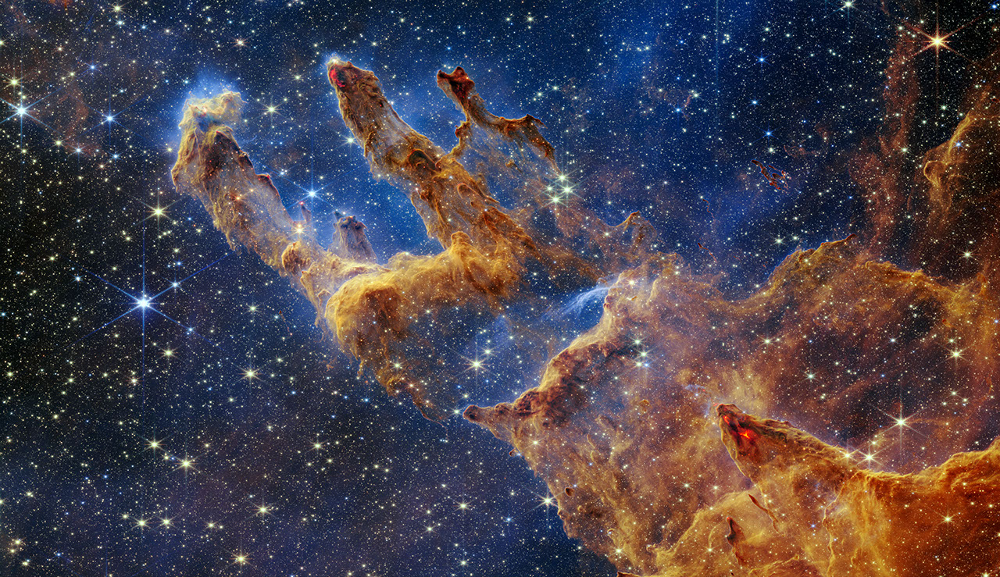

<!-- README profil GitHub untuk yozophy: repo bernama "yozophy" (sama dengan username) -->

 

<i>Pillars of Creation, Nebula Elang (M16). Kredit gambar: NASA, ESA, CSA, STScI.</i>

 

---

## 🌌 About Me

My fascination with the cosmos is the compass by which I live. In the Pillars of Creation, clouds of gas and dust collapse slowly under their own gravity until new stars ignite. I take this as a model for how I learn and work: understanding forms through patient, incremental effort, until it begins to shine.

<ul> <li>🔭 Currently working on: <code>Research on Photovoltaic Power Output Prediction Using Ensemble Learning Algorithms</code></li> <li>🔭 Currently working on: <code>Research on Redshift Analysis Using SDSS Data</code></li> <li>🌱 Currently learning: <code>Machine Learning, Physics, Computational Physics, Astronomy</code></li> <li>💬 Ask me about: <code>Astronomy</code></li> <li>📫 Contact: <code>-</code></li> </ul>

## 🛰️ Tools

<!-- Tambah atau ganti badge sesuai teknologi yang dipakai: https://shields.io dan https://simpleicons.org -->

## 🔗 Proyek Pilihan

| Proyek | Deskripsi |
| --- | --- |
| [`nama-proyek-1`](https://github.com/yozophy/nama-proyek-1) | Deskripsi singkat proyek |
| [`nama-proyek-2`](https://github.com/yozophy/nama-proyek-2) | Deskripsi singkat proyek |

---

<i>"We are star stuff." — Carl Sagan</i>

