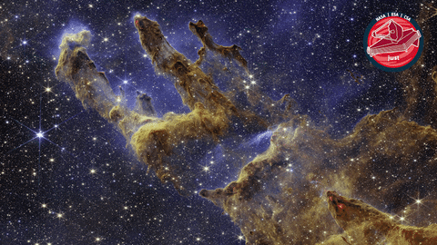

<!-- README profil GitHub untuk yozophy: repo bernama "yozophy" (sama dengan username) -->

 

<i>Pillars of Creation, Nebula Elang (M16). Kredit gambar: NASA, ESA, CSA, STScI.</i>

  

<i>GIF: ESA/Webb via GIPHY.</i>

---

## 🌌 About Me

Seperti Pillars of Creation, sebuah proyek besar dimulai dari gumpalan gas dan debu yang pelan-pelan runtuh oleh gravitasi, lalu menjadi bintang baru. Begitu juga cara saya belajar dan membangun: sedikit demi sedikit, sampai ada yang menyala.

- 🔭 Sedang mengerjakan: `Penelitian terkait Prediksi Daya Keluaran Fotovoltaik Berbasis Algoritma Ensemble Learning`
- 🌱 Sedang dipelajari: `Machine Learning, Physics, Computational Physics`
- 💬 Tanya saya soal: `Astronomi`
- 📫 Kontak: `-`

## 🛰️ Tools

<!-- Tambah atau ganti badge sesuai teknologi yang dipakai: https://shields.io dan https://simpleicons.org -->

## 🔗 Proyek Pilihan

| Proyek | Deskripsi |
| --- | --- |
| [`nama-proyek-1`](https://github.com/yozophy/nama-proyek-1) | Deskripsi singkat proyek |
| [`nama-proyek-2`](https://github.com/yozophy/nama-proyek-2) | Deskripsi singkat proyek |

---

<i>"We are star stuff." — Carl Sagan</i>

